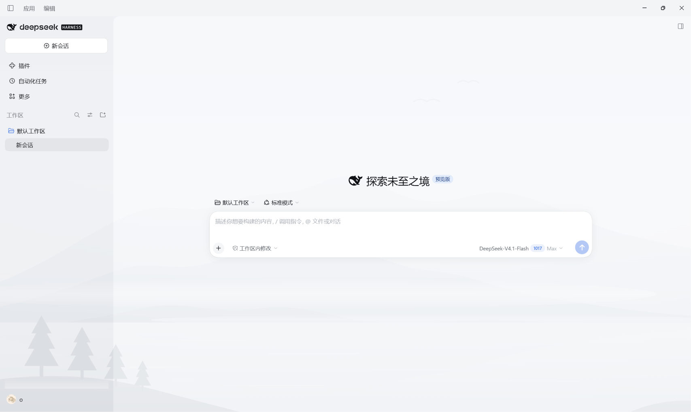
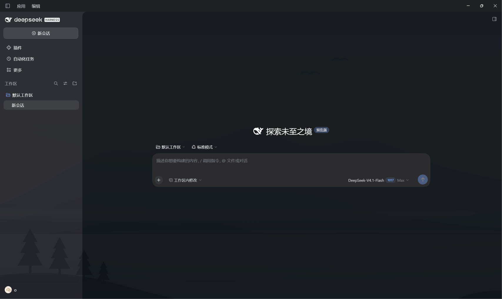

# dsh-plugin-landscape-bg

<div align="center">

**给 dsh Web 客户端铺一张风景画当背景。**

纯 CSS / token 注入，不改 dsh 本体；桌面、侧栏、内容区都透出同一幅画，
Windows 标题栏与圆角缺口一并抹平。

[](https://www.npmjs.com/package/dsh-plugin-landscape-bg)
[](./LICENSE)
[](#兼容性)
[](./package.json)

<p>
  
  
</p>

</div>

## 这是什么

`dsh-plugin-landscape-bg` 是一个 [dsh](https://www.npmjs.com/package/@deepseek-ai/dsh) **Web 客户端插件**。它在客户端启动时注入一段样式表与一层主题 token 覆盖：

- 把一幅内嵌的 SVG 风景画（天空 / 三重山脊 / 雾气 / 倒影湖面 / 前景松林 / 飞鸟）铺成整页背景；
- 把表面色改成半透明，让画透出来而文字仍然清晰；
- 顺手修掉两处 Windows 上肉眼可见的瑕疵：原生标题栏按钮区与页面标题栏的色差、内容区左上角圆角处的浅色楔形缺口。

没有任何后台服务、工具或事件注册，卸载后样式与 token 覆盖一并撤销。

## 特性

| 能力 | 说明 |
| --- | --- |
| 风景画背景 | `html::before` 固定铺一张 `cover` 的画（`z-index:-1`），`html::after` 叠一层顶部径向暗角，压住大面积亮色，避免影响前景文字。 |
| 表面薄纱 | 把 `--dsw-alias-bg-base` 改成半透明（浅色 `0.55` / 深色 `0.64`）；壳层、基础表面、中心列各叠一层，使背景透出来而文字仍清晰。 |
| 标题栏一致性 | `body` 上保留不透明 caption 色，供原生 `setTitleBarOverlay` 探针读取；`#root` 内改回半透明。页面自绘的 40px 标题栏带刷成同一色，系统按钮区与页面标题栏读成一块。 |
| 圆角补齐 | Windows 下侧栏叠三层薄纱，中心列左上角 16px 圆角缺口只叠一层，缺口会偏亮成一道浅色楔。插件只在该缺口内补刷两层薄纱，用径向遮罩避开圆角本身。 |
| 浅色 / 深色 | 两套取值都写在 token 层里，主题切换时即时生效。 |
| 本地化名称 | `locale/zh.json` 提供中文名「风景画背景」与中文描述；中文界面显示中文，其它语言环境保持原有英文名 `dsh-plugin-landscape-bg` 与 `package.json.description`。 |
| 零依赖 | 效果全部集中在 `client.js`，背景图以 data URI 内嵌，不依赖资源服务路径。 |

## 安装

```bash
# 从 npm 安装到指定 profile
dsh plugin --profile <profile> add dsh-plugin-landscape-bg

# 或直接从 git 宿主安装（本包是纯 JS，无需构建）
dsh plugin --profile <profile> add github:horizonforge/dsh-plugin-landscape-bg

# 或本地 checkout
dsh plugin --profile <profile> add file:C:/work/dsh-plugin-landscape-bg
```

安装后重启 `dsh web`（或重新加载客户端）。也可以在 profile 配置里把 `dsh-plugin-landscape-bg` 加进 `dsh.profile.bundles`。

卸载：

```bash
dsh plugin --profile <profile> remove dsh-plugin-landscape-bg
```

## 调参

插件暴露的取值都集中在 `client.js` 顶部的几个常量里，改完重启客户端即可。

| 想改什么 | 改哪里 |
| --- | --- |
| 背景画 | `client.js` 的 `PAINTING`（SVG 字符串；换成自己的 `<svg>` 或 URL 都行） |
| 表面透画强度 | `SURFACES['--dsw-alias-bg-base']`（`light` / `dark` 两档 alpha） |
| 标题栏颜色 | `CAPTION`（需与系统标题栏一致，且必须**不透明**） |
| 壳层透画强度 | `stylesheet()` 里 `#root{--dsw-specific-sidebar-fill: …}` 两条 |
| 想让画透进标题栏 | 删掉 `client.js` 中 `::before{background:var(--dsh-landscape-caption)}` 那条规则，代价是按钮区与左侧会有轻微色差 |

## 兼容性

- 以 **web client 插件**形式注入 `@deepseek-ai/dsh-client-ui-theme`，随 dsh 客户端加载（`dsh.client.platform: web`，`immediately: true`）。
- 浅色 / 深色主题均适配。
- 标题栏带与圆角规则都包在 `[data-windows-titlebar]` 内，macOS / 纯浏览器不受影响；全屏（`data-fullscreen`）下标题栏带恢复透画。
- 圆角半径读 `--dsh-windows-content-radius`，标题栏高度读 `--dsh-windows-titlebar-height`，侧栏宽度读 `--dsh-windows-sidebar-width`，跟随 dsh 自身布局变量。
- 显示名的 locale 词典需要 dsh ≥ 0.2.0-rc.2。

## 显示名

显示文本由 Host 的 `readPluginMeta` 从 `locale/*.json` 读取，不激活插件。`en.json` 必须存在——它是 locale 目录的发现锚点——但刻意不带 `meta.title` / `meta.description`，让英文按回退链落到 `package.json.name` 与 `package.json.description`；`zh.json` 只覆盖中文。

| 界面语言 | 名称 | 描述 |
| --- | --- | --- |
| 中文 | 风景画背景 | 给 dsh Web 客户端铺一张风景画当背景。 |
| 英文或其它语言 | `dsh-plugin-landscape-bg` | `package.json.description` 的原文 |

若想让英文界面也用一个人可读的名字（例如 `Landscape Background`），在 `locale/en.json` 的 `meta.title` 里写上即可。

## 实现要点

| 关注点 | 做法 |
| --- | --- |
| 背景图 | `html::before` 固定铺底（`cover`），`html::after` 叠顶部径向暗角 |
| 表面透画 | `ctx.theme.overrideTokens()` 写入 token 层，改 `--dsw-alias-bg-base` 为半透明 |
| 标题栏 | `body` 保留不透明 caption 色给原生探针；`#root` 内改回半透明；页内 `::before` 带用同色 |
| 圆角 | 仅缺口处补两层径向薄纱，半径读 `--dsh-windows-content-radius` |

样式通过 `<style data-plugin="dsh-plugin-landscape-bg">` 注入，生命周期挂在 `ctx.effect()` 上，卸载即回收。

## 文件结构

```
dsh-plugin-landscape-bg/
├── assets/
│   ├── icon.svg          # 插件图标
│   ├── screenshot.png    # 效果截图（浅色）
│   └── screenshot-dark.png    # 效果截图（深色）
├── client.js             # 核心：背景、token 覆盖、标题栏 / 圆角修复
├── cordis.patch.yml      # cordis 覆盖层声明（仅插入本插件自身一行）
├── index.js              # Host 半侧入口（空实现，效果全在 Web 客户端）
├── LICENSE               # AGPL-3.0
├── locale/
│   ├── en.json           # 刻意留空：locale 目录的发现锚点，英文文本回落 package.json
│   └── zh.json           # 中文名称与描述
├── package.json          # 元信息（name / version / dsh.bundle / dsh.client）
└── README.md
```

## Model Experience

本插件只在 Web 客户端注入样式，不注册工具、服务、事件或模型可见文本，因此不影响模型输入、输出与 KV Cache。

## 已知限制

- 标题栏「与原生按钮同色」和「背景透到标题栏里」二选一：当前选前者（顶部 40px 是纯色带）。取舍见上文调参表。
- 圆角补齐依赖「侧栏叠三层薄纱、缺口叠一层」的现状；若 dsh 改变叠层方式，差值会重新出现。
- 背景图内嵌在 `client.js` 中，替换图片需要改该处并重启客户端。

## License

[AGPL-3.0](./LICENSE) © horizonforge
